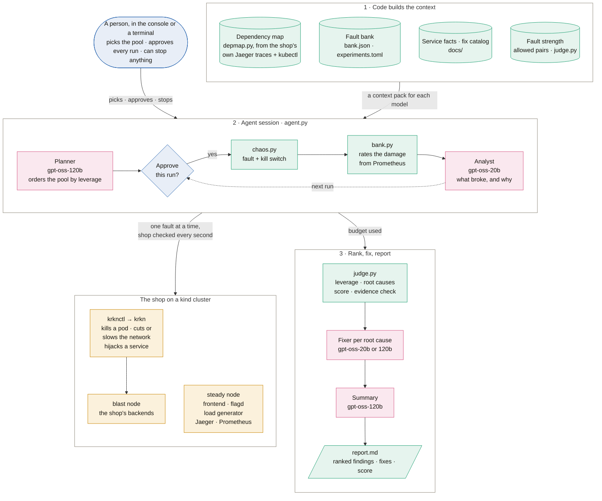

# Back-propagandist

AI-driven chaos engineering on a real online shop, the
[OpenTelemetry Astronomy Shop](https://github.com/open-telemetry/opentelemetry-demo) (about 20
services, Apache-2.0). Code maps the shop from its own traces, breaks it from the outside with
[krkn](https://github.com/krkn-chaos/krkn) and measures every service. Models plan the experiments
and explain what broke. A person approves every run. It all runs in a local kind cluster on one laptop.

[Architecture](#architecture) · [What we found](#what-we-found) · [Run it](#run-it) ·
[What's where](#whats-where) · [More](#more)

## Architecture



Blue: a person · green: code, which computes every number · pink: a model · amber: the cluster.

**A hybrid agent.** Code builds each model's context before it's asked and checks the answer
after. The models only rank, write hypotheses and explain. `agent.py` runs the session as a
LangGraph loop with one fresh model call per task, and nothing reaches the cluster without a
person's approval. Two workers give network faults a real network to slow, and monitoring sits on
the steady node, so a fault never blinds the kill switch.

### What each model reads, and what code checks after

| Model | Reads (packed by code) | Writes | Code checks after |
|---|---|---|---|
| **Planner** (the orchestrator), `gpt-oss-120b` | each fault in the pool: what it does, its strength, its target with the target's callers and risk flags from the map. Also the code-checked pairs, the run budget and the service facts. In a live session it also sees each fault's earlier rating. | the run order, with a hypothesis, a predicted tier and a reason for each | invented ids are dropped; faults it leaves out are added, mildest first; a person approves each run |
| **Analyst**, one per run, `gpt-oss-20b` | the fault and its target, the hypothesis, the **measured** tier, the broken SLOs, how long the damage lasted, every effect `bank.py` measured, the service facts | what happened, why, whether the hypothesis held, one follow-up | the measured tier stands; only real files can be cited; the evidence check scores the note; at most 2 follow-ups, never a broad fault |
| **Fixer**, one per root cause, `120b` if a finding is high, else `20b` | the findings that share the cause, the analyst's why, [`docs/fix-catalog.md`](docs/fix-catalog.md), the service facts | one fix, the change, the fault that proves it | the proving fault must exist; with no model, the catalog's row is used |
| **Summary**, `gpt-oss-120b` | the ranking, the fixes, the resilience score, the planner's hit rate | 3 to 5 sentences, next tests | the order and every number come from `judge.py`; next tests must be known faults |

The service facts are [`docs/service-facts.md`](docs/service-facts.md): what each service does and in what order,
read from the shop's source. Models run on Groq (`gpt-oss-120b` on key 1, `gpt-oss-20b` on keys 2 and 3),
with OpenRouter's `nemotron` as the last fallback. With no keys at all, rules do everything and
each text is marked "(no AI)". Keys: [step 1 of Run it](#1-replay-on-any-laptop-linux-macos-or-windows).

### The dependency map, from the shop's own traces

We add no tracing of our own: the shop already sends OpenTelemetry traces to Jaeger.
`depmap.py` builds the map from:

- **Jaeger** (`/api/dependencies`, the last 15 minutes): who calls whom, and how often.
- **kubectl** (`get deploy,statefulset`): data stores (Valkey, Kafka, Postgres) send no traces, so
  their links come from each service's env vars. Ports, volumes and replicas give the risk flags:
  `no-persistence` (a store with no volume: a restart loses its data) and `hub` (3 or more callers).
- **The official diagram** ([`docs/official_edges.json`](docs/official_edges.json)) as a check: 35 of its 36
  links found, plus 10 real ones it leaves out. Our monitoring is cut out of the map, so it's never a target.

The map is used in three places:

- **The planner's context:** each target's callers and risk flags.
- **Pairs:** `judge.py` offers two faults as a pair only if they can meet: a shared caller within
  two hops, a node fault, the entry point or a load spike. Independent pairs never reach a model.
- **The console:** the map and the riskiest targets on its front page. Replay uses a recorded copy
  (`refs/dependency-map.json`).

### How it's scored

Two scores, never mixed. Every number comes from rules (`judge.py`), not from a model.
[docs/scoring.md](docs/scoring.md) has each formula, why we chose it, and a worked example.

- **Leverage** = impact ÷ fault strength ranks the findings. A small push that breaks a lot is the
  weakest point: blast-loss, 10 % packet loss → checkout errors, is 3 ÷ 1 = 3.0.
- **The resilience score** rates the system: krkn's formula over 7 SLOs a customer feels (15
  points per fault), summed over the pool. Ranking by damage instead would reward the strongest
  fault, krkn-ai's "break everything" trap.
- **The evidence check** scores each analyst note against the measurement (−40 for each contradicted
  claim). The **model's own estimate** is shown under it, marked unchecked.

### Safety controls

- **A person approves every run**, on a card in the console or in the terminal, and can skip or
  reorder runs. Following Bosch's AI code of ethics, people make the final call.
- **The kill switch** (`chaos.py`) checks the shop every second and stops krkn when a fault passes
  its limits (`experiments.toml`): p95, error rate, another pod down (blast radius) or the time limit.
  `touch runs/STOP`, Ctrl+C or **Emergency stop** end it at any time.
- **Cleanup** removes krkn's containers and helper pods, and any network delay left on the node.
- **One fault at a time** on the whole machine (a run lock).
- **Guards in code:** one target per run; no namespace-wide faults and nothing on the steady node;
  never two broad faults together; the controls never enter the pool.
- **Calibration:** two of the shop's planted bugs are known-answer controls. paymentFailure must
  rate high and adHighCpu low, or the measurement is broken, not the shop.

## What we found

| Result | Evidence |
|---|---|
| The map found 35 of the 36 links in the official diagram, plus 10 it leaves out. The biggest single point of failure is the feature-flag service (flagd), with 13 services depending on it. | `uv run python depmap.py --check`, [docs/progress.md](docs/progress.md) |
| Customers are charged, then lose the order: with shipping failing, 10 of 12 checkouts broke while all 14 card charges went through. Checkout charges before it ships and has no refund. | `bank.json`: `shipping-ship-errors` |
| **Fix verified.** Killing the product catalog went from high to low after 2 replicas and a 10 s preStop, 3 runs of 3. | [evidence/catalog-kill-fix/](evidence/catalog-kill-fix/README.md) |
| The kill switch stopped a 2,000 requests/s traffic spike 2.6 s after the first slow answer and cleaned up in 0.7 s. The shop was back to normal 1.9 s later. | [evidence/traffic-spike-runs.md](evidence/traffic-spike-runs.md) |
| Two faults at once: blast-latency + catalog-kill rates medium, so the catalog fix holds on a slow network. | [evidence/combo-pair-blast-latency+catalog-kill/](evidence/combo-pair-blast-latency+catalog-kill/README.md) |
| A live agent session ran 3 approved faults: findings ranked by leverage, a fix per root cause, resilience score 80/100. | [evidence/agent-live-session-1/report.md](evidence/agent-live-session-1/report.md) |
| Both known-answer controls passed the same day (2026-10-10). | `uv run python bank.py show` |

### The fault bank


Each fault is injected by krkn from outside the app and rated by measured damage, against the
quiet minutes before it. **High:** customers hit errors or lose data, or the shop doesn't
recover. **Medium:** another service errors, or the customer side is 2x slower. **Low:** anything less.

- **High:** shipping-ship-errors, quote-garbage, currency-down, blast-loss, catalog-db-cutoff, cart-wipe
- **Medium:** blast-latency, cpu-starve, recommendation-cutoff
- **Low:** catalog-kill (high before the fix), payment-kill, kafka-outage, blast-memory
- **Pairs:** blast-latency + catalog-kill medium; blast-latency + catalog-db-cutoff and cart-wipe + traffic-spike high
- **Controls:** paymentFailure high ✓, adHighCpu low ✓

`uv run python bank.py show` prints every effect behind each rating. The Live run page draws the
same heatmap live.

## How we measure

- **The shop:** 5 checks before give its normal speed (an unhealthy shop refuses the run), one a
  second during gives the impact, and checks after until 5 in a row are normal give the recovery
  time. Every check is in `runs/<id>/events.jsonl`; `summary.json` is computed from it.
- **Every service:** `bank.py` compares each service's errors, p95 and throughput (from the traces
  in Prometheus), plus CPU, memory, restarts and cart contents, with the quiet minutes before the fault.

## Run it

There are two ways to run it:

- **Replay, on any laptop.** No cluster; setup is a clone and `uv sync`. The agent replays the ratings
  recorded in `bank.json`, and the console shows the map recorded on our cluster.
- **Live.** A kind cluster with the shop, and real faults. About 20-40 minutes the first time,
  mostly image downloads. Tested on Arch Linux (Ryzen 7 6800H, 16 threads, 16 GB RAM).

### 1. Replay on any laptop (Linux, macOS or Windows)

You need git, [uv](https://docs.astral.sh/uv/) and Python 3.12+ (uv installs it if missing).

```bash
git clone https://github.com/StrikerEureka34/Back-propagandist && cd Back-propagandist
uv sync
cp .env.example .env        # then fill in the keys you have (below); empty is fine
uv run pytest -q            # 99 tests, no cluster or keys needed
uv run streamlit run app.py # console at http://localhost:8501; run it from the repo root
```

On the console's **Agent** page, pick **Replay**, tick the faults, and press **Start session**.
Or from a terminal:

```bash
uv run python agent.py --replay bank.json --auto-approve        # every rated fault, budget 8
uv run python agent.py --replay bank.json --pool quote-garbage,cart-wipe,currency-down --budget 3
```

Without `--auto-approve`, the agent asks you to approve each run in the terminal. The report
goes to `runs/session-<time>/report.md`, with `session.json` next to it. A sample is in
`evidence/agent-replay-report.md`.

**AI keys (`.env`).** Every key is optional. A key that's missing is skipped and the next one
in the chain answers:

| Variable | Used for |
|---|---|
| `GROQ_API_KEY` | the planner, the report summary and high-severity fixes (`openai/gpt-oss-120b`) |
| `GROQ_API_KEY_2`, `GROQ_API_KEY_3` | the analyst for each run, and medium/low fixes (`openai/gpt-oss-20b`) |
| `OPENROUTER_API_KEY` | the last fallback for every role (`nvidia/nemotron-3.5-lightning:free`) |

Free keys: [console.groq.com](https://console.groq.com/keys) and
[openrouter.ai](https://openrouter.ai/keys). Groq limits each organization, so a second key from
the same account adds no capacity. **With no keys at all, the agent still runs.** Rules order
the faults, and every text the models would write is marked "(no AI)". Every number comes from
rules either way. Answers are cached in `runs/llm-cache/`, so the same session replayed twice costs nothing.

### 2. Live: build the cluster (once)

You need docker, kubectl, helm, jq, curl, uv, [kind](https://kind.sigs.k8s.io/) v0.33.0 and
[krknctl](https://github.com/krkn-chaos/krknctl) v0.14.2-beta. Tested with docker 29.8,
kubectl 1.37, helm 4.3 and Kubernetes 1.37 nodes. krknctl runs krkn in a Docker container and
pulls its image on first use, so the first fault needs internet.

```bash
kind create cluster --config k8s/kind.yaml        # control plane + 2 workers, ports 8080 and 9090
helm repo add open-telemetry https://open-telemetry.github.io/opentelemetry-helm-charts
helm install otel open-telemetry/opentelemetry-demo --version 0.42.3 -n otel-demo \
  --create-namespace -f k8s/otel-values.yaml --wait --timeout 20m
# the catalog-kill fix (#19): helm can't set this, so re-apply it after every install or upgrade
kubectl patch deployment product-catalog -n otel-demo --patch-file k8s/product-catalog-patch.yaml
```

Check that it came up:

```bash
kubectl get nodes                                  # chaos-control-plane, chaos-worker, chaos-worker2: Ready
kubectl get pods -n otel-demo                      # all Running (ad restarting now and then is known, see below)
curl -s -o /dev/null -w "%{http_code}\n" localhost:8080          # 200: the shop
curl -s localhost:9090/-/ready                                    # Prometheus is Ready
uv run python depmap.py --check                    # found 35 of 36 official links, 10 extra
```

Shop, Jaeger and Grafana are at http://localhost:8080 (`/jaeger/ui`, `/grafana`). Prometheus is
at http://localhost:9090. Give the load generator about 5 minutes after install before the
first fault, so there's traffic to compare against.

Short on memory (under 3 GB free)? Follow the comments in `k8s/otel-values.yaml` to switch off
agent, chatbot, mcp and opensearch, then uninstall and install again. The chart can't change
these in place.

### 3. Live: run faults

One fault at a time, across the whole machine. A second run is refused with "another fault is
running". A run also refuses to start while the shop is unhealthy.

```bash
uv run python chaos.py list                            # the failure menu
uv run python chaos.py run catalog-kill                # one fault + kill switch; writes runs/<id>/
uv run python chaos.py run blast-latency+catalog-kill  # a pair under one kill switch
uv run python bank.py run quote-garbage cart-wipe      # rate faults high / medium / low into bank.json
uv run python bank.py run control-payment-failure control-ad-cpu   # the two known-answer controls
uv run python bank.py show                             # the bank, every effect behind each rating
```

- **How long:** about 3-5 minutes per fault in `bank.py`, plus a 5-minute quiet wait first if
  a fault ran recently. A dirty baseline once rated shipping-ship-errors low; the wait is the fix.
- **Rate faults by name, not with `bank.py run all`.** `all` includes `traffic-spike`, whose
  slowness and error limits are switched off on purpose, so only the blast-radius check or a
  manual stop ends it early.
- **Controls:** `control-payment-failure` must rate high and `control-ad-cpu` low. If either
  fails, the measurement is broken, not the shop. `bank.py show` marks pass or FAIL.

### 4. Live: an agent session

```bash
uv run python agent.py --pool shipping-ship-errors,quote-garbage,currency-down,catalog-db-cutoff,cart-wipe --budget 5
```

Or use the console's **Agent** page (Live): pick the pool, then approve, skip or stop each run
on its card. Drag the queue to change the order. **Emergency stop** ends the whole session.

- `--pairs` also lets the planner queue code-checked pairs. It only queues one when it expects
  the pair to show something neither fault shows alone.
- The analyst can add up to 2 follow-up faults per session. You still approve each one.
- Plan on 5-15 minutes per run, because each rating waits for the damage to clear.
- The output goes to `runs/session-<time>/`: `report.md`, `session.json`, `progress.json`, and
  `agent.log` when started from the console. A recorded live session is in
  `evidence/agent-live-session-1/`.

### Stop anything, at any time

`touch runs/STOP` from any terminal, Ctrl+C, or Emergency stop on the Agent page. The runner
kills krkn, removes its containers and helper pods, and clears a node network fault krkn
left behind. The next session or bank run clears the STOP file itself.

### If something goes wrong

| What you see | What to do |
|---|---|
| `another fault is running (...)` | A run is still going, maybe in another terminal or the console. Wait for it, or `touch runs/STOP`. |
| `shop not healthy ... refusing to inject` | The last fault hasn't cleared yet. Wait, check `kubectl get pods -n otel-demo`, then run again. |
| `refused a+b: ...` | That pair is forbidden by `judge.py`: a control, two broad faults, or the same target twice. |
| The `ad` pod keeps restarting | Known. It runs out of memory (limit 300Mi) on its own; see #12. Ad cells in the bank are noise and only low tier. |
| A hard crash left something behind | `docker ps -a \| grep krknctl` (remove with `docker rm -f`), `kubectl get pods -n default` (krkn helper pods), and `docker exec chaos-worker tc qdisc show` (a leftover `netem` slows the backend node). |
| catalog-kill rates high again | The preStop patch was lost by a helm upgrade. Re-run the `kubectl patch` line in step 2. |
| The console shows old behaviour after a pull | Restart Streamlit; it doesn't reload modules other than the page. |
| The theme is missing | Streamlit was started outside the repo root. |
| `rate limited, waiting N s` | Groq's free tier. The agent waits up to 60 s, then falls back to the next key. |
| Windows | Replay and the console work. Live faults and the run lock need Linux. |

## What's where

```
app.py              the console (Streamlit): dependency map, risk table
pages/              console pages: Live run (shop health, per-service damage, the bank),
                    Agent (pick faults, approve each run, results ranked by leverage)
agent.py            the agent: planner (Groq gpt-oss-120b) + analysts (gpt-oss-20b), you approve every run
judge.py            the rules: leverage, resilience score, root causes, safe pairs, evidence check on AI notes
depmap.py           builds the dependency map and the risk flags
chaos.py            runs a krkn experiment, watches it, stops it, cleans up
bank.py, bank.json  rates each fault high / medium / low from measured effects
heat.py             the heatmaps on the Live run page
agent_flow.py/.html the animated agent diagram on the Agent page
experiments.toml    the failure menu and each one's stop limits
scenarios/          krkn scenario files (service hijacking)
k8s/                kind cluster config + shop install settings
tests/              tests: map, kill switch, run lock, pairs, bank rules, agent, heatmaps
docs/               problem statement, official diagram edges, progress notes
evidence/           results from our runs on the cluster
runs/               output of each run (local only)
```

## More

- [docs/decisions-and-lessons.md](docs/decisions-and-lessons.md): what we decided each day, why, and what went wrong
- [docs/scoring.md](docs/scoring.md): leverage, SLO points, the resilience score, the evidence check and the model's own estimate, with examples
- [docs/fix-catalog.md](docs/fix-catalog.md): the fixes the fixer picks from, one per root cause
- [docs/service-facts.md](docs/service-facts.md): what each service does, as the models read it
- [docs/hackathon-problem-statement.md](docs/hackathon-problem-statement.md): the challenge, transcribed from the slides
- [docs/progress.md](docs/progress.md): what's done and what's left, per day
- [evidence/](evidence/): raw files from every run quoted above
